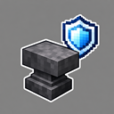
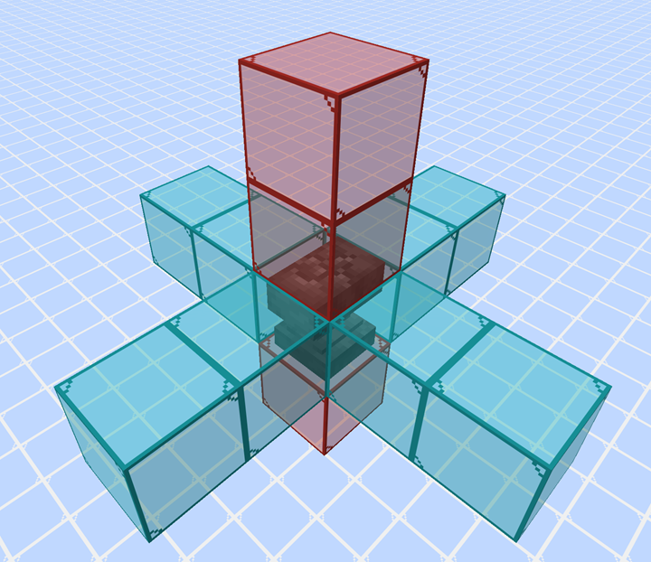

<kbd></img></kbd>

# Never-Breaking Anvil

A Minecraft data pack that prevents anvils from breaking.

Chipped and damaged anvils within a specified area around each player are automatically repaired.

It works in both single-player worlds and multiplayer servers.

金床が壊れるのを防ぐマインクラフトのデータパックです。

プレイヤーの位置を中心に、東西南北にそれぞれ2ブロック、上に2ブロック、下に1ブロックの範囲内にある劣化した金床が自動的に修復されます。

シングルプレイとマルチプレイのどちらにも対応しています。

## Latest Release

1.0.0

## Java Edition

### Minecraft 26.1 / 26.1.1 / 26.1.2 / 26.2 / 26.3 or later

1. Download `NeverBreakingAnvil.zip` from the `1.0.0` directory.

2. Place the downloaded file in your Minecraft `datapacks` folder.

On Windows, the default location is:

`C:\Users\<Username>\AppData\Roaming\.minecraft\saves\<World>\datapacks`

## Images

Repair Range / 修復される範囲

